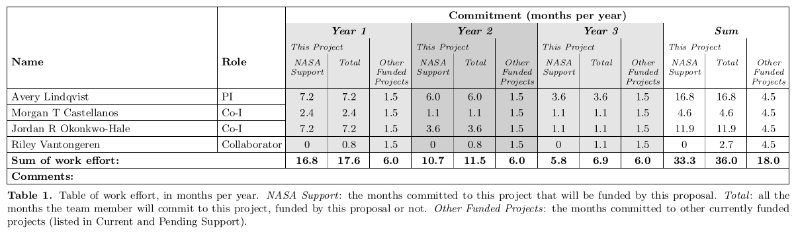

<!--------------------------------------
   SCREEN SHOT
--------------------------------------->
<table>
<tr>
<td>
<b>NOTANONworkEffort</b>
 

</td>
<td>

<b>NOTANONworkEffort</b> (description)

<b>NOTANONworkEffort</b> is NASA's Table of Work Effort (as in the Earth Science Division's template): for each team
member and each year, the months committed to this project that this proposal funds (<i>NASA Support</i>), all the
months they commit to this project, funded by this proposal or not (<i>Total</i>), and the months committed to other
currently funded projects (<i>Other Funded Projects</i>); then the sums over the years (<i>Sum</i>) and over the team
(<i>Sum of work effort</i>), and a Comments row.

</td>
</tr>
</table>

<!--------------------------------------
   HOW TO USE
--------------------------------------->
<b>HOW TO USE:</b>

<!-- - - - - - - - - - - - - - - - - - - - - - - - - - - -
             Special Packages
- - - - - - - - - - - - - - - - - - - - - - - - - - - - -->

<b>Load worpt.sty</b> [<i>one-time-only task</i> for inclusion of any/all WorPT files]

Add this line to the preamble of your document, as the last package loaded (after aastex, xcolor, hyperref and the rest). It loads only the few packages the WorPT tables need, and skips any your document has already loaded. The file <code>worpt.sty</code> comes with the tables (see https://github.com/pmarcum/WorPT/blob/main/latexTableTemplates/WorPTpackages for more info).
<pre><code>
\usepackage{worpt}
</code></pre>

<!-- - - - - - - - - - - - - - - - - - - - - - - - - - - -
             Where the numbers come from
- - - - - - - - - - - - - - - - - - - - - - - - - - - - -->

<b>Where the numbers come from</b>

<ul>
<li><i>NASA Support</i> and <i>Total</i> come from the work plan: a person's funded FTE in a year, and all their FTE that year (funded and unfunded), as the other WorPT tables show them, times 12, to one decimal. A collaborator's NASA Support is always 0.</li>
<li><i>Other Funded Projects</i>: in WorPT's Team tab, under "Months on other currently funded projects", enter for each person and each year the months committed to other <b>currently</b> funded projects (those listed in Current and Pending Support; not pending ones). Anyone on the work plan may enter them.</li>
<li>The <i>Sum</i> columns add up each person's years, and the <i>Sum of work effort</i> row adds up the team, using the months as shown (so the sums always match the numbers above them).</li>
<li>No months at all is shown as 0.</li>
<li>The team is listed as in the other tables: PI, Science PI, Admin PI, Co-Is, postdocs, grad and undergrad students, anyone with another role, collaborators; by last name within each.</li>
</ul>

<!-- - - - - - - - - - - - - - - - - - - - - - - - - - - -
             Putting File Contents Into Document
- - - - - - - - - - - - - - - - - - - - - - - - - - - - -->

<mark><b>How To Put File Contents Into Your Document</b></mark> [<i>one-time-only task for inclusion of this file</i>]

<ol>
<li>COPY the lines in the code block below, then</li>
<li>PASTE into your document WHERE you want the content to appear, then</li>
<li>MODIFY the editable lines you just pasted in your document as needed: the caption, and the text of the Comments row (in <code>\def\WorkEffortComments{...}</code>, e.g. who funds the time NASA does not, with footnotes if you like).</li> 
Refer to <b>Customizations</b> section below to add personal preferences in the gap between \input and \begin{NOTANONworkEffort} lines below.
</ol>

<pre><code>
%:::::::::::::::: start NOTANONworkEffort :::::::::::::::::
\input{NOTANONworkEffort} % reset file parameters
%\LandScapetrue               % [optional] turn the table sideways, on a page of its own
%\def\WorkEffortAcrossPages{always} % [optional] auto (default): one page if it fits, else across pages; always; never
\def\WorkEffortComments{}     % [optional] the text of the table's Comments row (e.g. who funds the time not paid by NASA)

\begin{NOTANONworkEffort}
\caption{Table of work effort, in months per year. \emph{NASA Support}: the months committed to this project that will be funded by this proposal. \emph{Total}: all the months the team member will commit to this project, funded by this proposal or not. \emph{Other Funded Projects}: the months committed to other currently funded projects (listed in Current and Pending Support).}
\label{tab:NOTANONworkEffort}
\end{NOTANONworkEffort}
%:::::::::::::::::: end NOTANONworkEffort ::::::::::::::::::
</code></pre>

<!-- - - - - - - - - - - - - - - - - - - - - - - - - - - -
             Customizations
- - - - - - - - - - - - - - - - - - - - - - - - - - - - -->

<b>Customize appearance</b> [<i>do as many times as needed</i>]

COPY any of the lines below (they show the default values), PASTE them into your document <b>between</b> the \input and \begin{NOTANONworkEffort} lines, and EDIT them there. <i>Highlights show what can be edited.</i> Comment out a pasted line to go back to its default.

<table>

<tr>
<td><b>The Comments row</b></td>
<td><pre><code>
\def\WorkEffortComments{<mark></mark>}   % the text after "Comments:" (empty by default)
\def\CommentsLabel{<mark>\textbf{Comments:}</mark>}
</code></pre></td>
</tr>

<tr>
<td><b>A table too tall for one page</b></td>
<td><pre><code>
\def\WorkEffortAcrossPages{<mark>auto</mark>}   % auto, always or never
\def\ContinuedFormat{<mark>\scriptsize\itshape</mark>}   % the "continued" notes
\def\ContinuedBelowText{<mark>continued on next page</mark>}
\def\ContinuedAboveText{<mark>\tablename~\thetable\ (continued)</mark>}
</code></pre>
With <code>auto</code> (the default), the table is on one page when it fits there, a table that floats like the others. When it doesn't (a large team), it is set where its paste-in block is in your text and runs on over as many pages as it needs: its headings are repeated at the top of each page, "continued on next page" is written under each part but the last and "Table N (continued)" above each part but the first, and the sums, the Comments row and the caption come once, together, at the end. <code>always</code> sets it that way even when it would fit; <code>never</code> keeps it on one page. In landscape mode it does the same on pages turned sideways, starting on a page of its own (your text resumes, upright, on the page after). In a two-column document it runs across both columns: aastex and revtex start it below the text before it and resume the two columns under it; other classes (article, report) give it pages of its own.
</td>
</tr>

<tr>
<td><b>Column widths and landscape mode</b></td>
<td><pre><code>
\LandScapetrue                          % always in landscape mode
\def\MinNameWidth{<mark>1.2in</mark>}              % narrowest Name column
\def\SpaceBetweenColumns{<mark>3pt</mark>}         % spacing between columns (the most it gets)
\def\MinSpaceBetweenColumns{<mark>1pt</mark>}      % the least spacing between columns
\def\SpaceBetweenRows{<mark>1</mark>}               % vertical compactness of rows
</code></pre>
The table is always as wide as the page's text. The month columns are all as wide as their widest number or heading word; the Role column is as wide as its widest role; the Name column gets the width that is left (a long name takes a second line). If that would be narrower than <code>\MinNameWidth</code>, the spacing between columns is made smaller, just enough, but not below <code>\MinSpaceBetweenColumns</code>; if that is not enough, the table is set in landscape mode (where the spacing is made smaller again if need be); and if even that is not enough (five years, say), the headings over the months are set in <code>\SmallSubheadFont</code>, which makes the month columns narrower. Without <code>\LandScapetrue</code>, a table of one or two years is usually upright, and one of three or more sideways, as in NASA's template.
</td>
</tr>

<tr>
<td><b>Shading and lines</b></td>
<td><pre><code>
\def\WorkEffortOddYearColor{<mark>gray!20</mark>}   % Year 1, Year 3, Year 5 ...
\def\WorkEffortEvenYearColor{<mark>gray!38</mark>}  % Year 2, Year 4 ...
\def\WorkEffortSumColor{<mark>white</mark>}         % the Sum columns
\def\WorkEffortSumRowColor{<mark>white</mark>}      % the "Sum of work effort" row
\def\NasaTotalLineColor{<mark>gray</mark>}          % the line between NASA Support and Total
</code></pre>
NASA's template draws a dashed line between NASA Support and Total; here it is a thin gray line (a dashed line that fits each row would need a package that changes every table in your document).
</td>
</tr>

<tr>
<td><b>Headings</b></td>
<td><pre><code>
\def\NameLabel{<mark>\textbf{Name}</mark>}
\def\RoleLabel{<mark>\textbf{Role}</mark>}
\def\CommitmentLabel{<mark>\textbf{Commitment (months per year)}</mark>}
\def\YearLabel#1{<mark>\textbf{\textit{Year #1}}</mark>}
\def\SumLabel{<mark>\textbf{\textit{Sum}}</mark>}
\def\SubheadFont{<mark>\scriptsize\itshape</mark>}       % the headings over the months
\def\SmallSubheadFont{<mark>\tiny\itshape</mark>}        % the same, for a table too wide otherwise
\def\ThisProjectLabel{<mark>This Project</mark>}
\def\NasaSupportLabel{<mark>NASA Support</mark>}
\def\TotalLabel{<mark>Total</mark>}
\def\OtherFundedLabel{<mark>Other Funded Projects</mark>}
</code></pre></td>
</tr>

<tr>
<td><b>Rows</b></td>
<td><pre><code>
\def\NameFormat#1{<mark>#1</mark>}          % a team member's name
\def\RoleFormat#1{<mark>#1</mark>}          % their role
\def\MonthsFormat#1{<mark>#1</mark>}        % months (one decimal)
\def\ZeroMonths{<mark>0</mark>}             % how no months at all are shown
\def\SumRowLabel{<mark>\textbf{Sum of work effort:}</mark>}
\def\SumFormat#1{<mark>\textbf{#1}</mark>}  % the months in the "Sum of work effort" row
</code></pre></td>
</tr>

</table>

<!--------------------------------------
   NUCLEAR OPTION
--------------------------------------->

<b>NUCLEAR OPTION</b> <i>[when nothing else works]</i>

If you just cannot get the table to look like you want it to look, you can always copy/paste the entire NOTANONworkEffort.tex file that appears in the WorPT subfolder, into your document, and then edit at-will.  Some of the WorPT files involve complicated LaTeX code, so be sure that you have a good mastery of LaTeX and know what you are doing before implementing this option!

