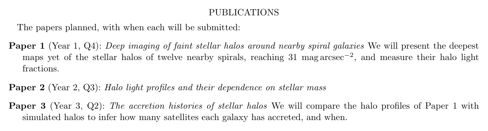

<!--------------------------------------
   SCREEN SHOT
--------------------------------------->
<table>
<tr>
<td>
<b>isANONpapers</b>
 

</td>
<td>

<b>isANONpapers</b> (description)

<b>isANONpapers</b> is NOT a table, but the list of papers the work plan says will be written: every category, task or
subtask whose title starts with <i>Paper:</i> (for example <i>Paper: Deep imaging of faint stellar halos</i>; any
capitals, any spaces; a number typed before the colon, as in <i>Paper 2:</i>, is ignored) is a paper. WorPT numbers the
papers itself, by when they finish: the quarter in which the paper's timeline ends (or its last subtask's), earliest
first; papers finishing in the same quarter keep the plan's order, and a paper with no timeline comes last.
Each paper's description is the <i>Description</i> typed for its item in WorPT's plan (the descriptions of other items
are never printed). <code>\listplannedpapers</code> lists the papers in number order:
<b>Paper 1</b> (Year 1, Q4): <i>title</i> description ...
The schedule and task tables name each paper the same way (<i>Paper 1: title</i>), and WorPT's Plan tab shows each
paper's number and finish beside its title.

</td>
</tr>
</table>

<!--------------------------------------
   HOW TO USE
--------------------------------------->
<b>HOW TO USE:</b>

<!-- - - - - - - - - - - - - - - - - - - - - - - - - - - -
             Special Packages
- - - - - - - - - - - - - - - - - - - - - - - - - - - - -->

<b>Load worpt.sty</b> [<i>one-time-only task</i> for inclusion of any/all WorPT files]

Add this line to the preamble of your document, as the last package loaded (after aastex, xcolor, hyperref and the rest). It loads only the few packages the WorPT tables need, and skips any your document has already loaded.
<pre><code>
\usepackage{worpt}
</code></pre>

<!-- - - - - - - - - - - - - - - - - - - - - - - - - - - -
             The papers in the work plan
- - - - - - - - - - - - - - - - - - - - - - - - - - - - -->

<b>The papers in the work plan</b>

<ul>
<li>Title each paper's task (or subtask) <i>Paper: title</i>, give it a timeline that ends when the paper is to be submitted, and type what the paper will present in its <i>Description</i>.</li>
<li>The title and description are LaTeX: your own commands (\RST) and references (Sec.~\ref{sec:methods}) work, since they are worked out in your document. A bare &amp;, % or # is printed as typed. The description's paragraphs are kept.</li>
<li>The numbers follow the timeline: moving a paper's timeline, or adding a paper that finishes earlier, renumbers the papers after it, in the list and in every table, at the next compile.</li>
<li>WorPT warns (on the dashboard, its Tables tab and in gooTeX's log) when a paper has no timeline (it is listed last, with no date) or a <i>Paper:</i> has no title after it.</li>
</ul>

<!-- - - - - - - - - - - - - - - - - - - - - - - - - - - -
             Putting File Contents Into Document
- - - - - - - - - - - - - - - - - - - - - - - - - - - - -->

<mark><b>How To Put the List Into Your Document</b></mark> [<i>one-time-only task for inclusion of this file</i>]

<ol>
<li>COPY the lines in the code block below, then</li>
<li>PASTE into your document WHERE you want the list of papers to appear.</li>
</ol>
Refer to <b>Customizations</b> section below to add personal preferences in the gap between the \input and \listplannedpapers lines below.

<pre><code>
%:::::::::::::::::: start isANONpapers ::::::::::::::::::::
\input{isANONpapers} % the papers planned in the work plan
\listplannedpapers
%::::::::::::::::::: end isANONpapers :::::::::::::::::::::
</code></pre>

<!-- - - - - - - - - - - - - - - - - - - - - - - - - - - -
             Customizations
- - - - - - - - - - - - - - - - - - - - - - - - - - - - -->

<b>Customize appearance</b> [<i>do as many times as needed</i>]

COPY any of the lines below (they show the default values), PASTE them into your document, either in the preamble after <code>\usepackage{worpt}</code> or <b>between</b> the \input and \listplannedpapers lines, and EDIT them there. <i>Highlights show what can be edited.</i>

<table>

<tr>
<td><b>The list of papers</b></td>
<td><pre><code>
\def\PlannedPaperLabel#1{<mark>\textbf{Paper~#1}</mark>}     % each paper's label (#1 is its number)
\PlannedPaperDates<mark>true</mark>                             % false: no finish dates
\def\PlannedPaperDate#1#2{<mark>Year~#1, Q#2</mark>}         % a finish date (#1 the year, #2 the quarter)
\def\PlannedPaperDateFormat#1{<mark> (#1)</mark>}            % how the date follows the label
\def\PlannedPaperLabelEnd{<mark>:</mark>}                    % after the label and date
\def\PlannedPaperFormat#1{<mark>\emph{#1}</mark>}            % each title
\PlannedPaperDescriptions<mark>true</mark>                      % false: the titles only
\def\PlannedPaperSeparator{<mark> </mark>}                   % between a title and its description (e.g. {: } or {. })
\def\PlannedPaperDescriptionFormat#1{<mark>#1</mark>}        % each description
\def\PlannedPapersIndent{<mark>1.5em</mark>}                 % how far a paper's later lines are indented
\def\PlannedPapersSpace{<mark>\itemsep</mark>}                % space between papers (a length, e.g. 2pt)
\def\NoPlannedPapersText{<mark>\textbf{??} (no planned papers: the work plan has no tasks titled ``Paper: title'')</mark>}
</code></pre>
For <b>Publication I</b>, <b>Publication II</b> ... (capital Roman numerals), use
<pre><code>
\def\PlannedPaperLabel#1{\textbf{Publication~\WorPTRoman{#1}}}
</code></pre>
and for dates such as <i>Y2 Q3</i>, <code>\def\PlannedPaperDate#1#2{Y#1~Q#2}</code>.
Each paper is a paragraph starting with its label; a long title or description wraps with its later lines indented.
When the work plan has no papers yet, the list is <code>\NoPlannedPapersText</code> instead, and the LaTeX log says so.</td>
</tr>

</table>

<!--------------------------------------
   NUCLEAR OPTION
--------------------------------------->

<b>NUCLEAR OPTION</b> <i>[when nothing else works]</i>

If you just cannot get the list to look like you want it to look, you can write your own list in your document instead, from the papers shown in WorPT's Plan tab.

