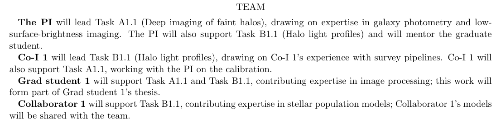

<!--------------------------------------
   SCREEN SHOT
--------------------------------------->
<table>
<tr>
<td>
<b>isANONteamSummaries</b>
 

</td>
<td>

<b>isANONteamSummaries</b> (description)

<b>isANONteamSummaries</b> is NOT a table, but rather a file containing a paragraph for each team member describing
their role in the proposed project, for proposals that must not identify the team. It is the same text as
<b>NOTANONteamSummaries</b> (the team summary written for each person on WorPT's Team tab), but each paragraph starts
with the person's role instead of their name (<i>The PI</i>, <i>The Science PI</i>, <i>The Admin-PI</i>, <i>Co-I 1</i>,
<i>Postdoc 1</i>, <i>Grad student 1</i>, <i>Undergrad 1</i>, <i>Collaborator 1</i>, numbered as in the other anonymous
tables), boldfaced. In the text, WorPT replaces:
<ul>
<li>team members' names (with any title such as Dr.) with their role, as above;</li>
<li><i>she</i>, <i>he</i>, <i>her</i>, <i>him</i>, <i>his</i> and <i>hers</i> with the paragraph's own role (<i>her</i>
before a noun, <i>his</i> and <i>hers</i> become its possessive, e.g. <i>the PI's</i>), and <i>herself</i> and
<i>himself</i> with <i>themself</i>. WorPT takes these pronouns to mean the paragraph's own person; a capitalized
<i>He</i> inside a sentence, or before a numeral or ionization stage (He II), is taken to be helium and kept.</li>
</ul>
Nothing else in the text is changed. WorPT warns on its Tables tab if a paragraph still contains a team member's first or
last name or institution; anything else that could identify someone is up to the writer.

</td>
</tr>
</table>

<!--------------------------------------
   HOW TO USE
--------------------------------------->
<b>HOW TO USE:</b>

<!-- - - - - - - - - - - - - - - - - - - - - - - - - - - -
             Special Packages
- - - - - - - - - - - - - - - - - - - - - - - - - - - - -->

<b>Load worpt.sty</b> [<i>one-time-only task</i> for inclusion of any/all WorPT files]

Add this line to the preamble of your document, as the last package loaded (after aastex, xcolor, hyperref and the rest). It loads only the few packages the WorPT tables need, and skips any your document has already loaded. The file <code>worpt.sty</code> comes with the tables (see https://github.com/pmarcum/WorPT/blob/main/latexTableTemplates/WorPTpackages for more info).
<pre><code>
\usepackage{worpt}
</code></pre>

<!-- - - - - - - - - - - - - - - - - - - - - - - - - - - -
             Putting File Contents Into Document
- - - - - - - - - - - - - - - - - - - - - - - - - - - - -->

<mark><b>How To Put File Contents Into Your Document</b></mark> [<i>one-time-only task for inclusion of this file</i>]

<ol>
<li>COPY the lines in the code block below, then</li>
<li>PASTE into your document WHERE you want the content to appear, then</li>
<li>MODIFY the editable lines you just pasted in your document as needed. The lines that may be edited (or even deleted altogether if not wanted) are indicated by highlight below. </li> 
Refer to <b>Customizations</b> section below to add personal preferences in the gap between \input and \begin{isANONteamSummaries} lines below.

</ol>

<pre><code>
%:::::::::::::: start isANONteamSummaries :::::::::::::::::
\clearpage       % You can comment out or use \newpage instead
\input{isANONteamSummaries} % reset file parameters

\begin{isANONteamSummaries}
\end{isANONteamSummaries}
%::::::::::::::: end isANONteamSummaries ::::::::::::::::::
</code></pre>

<!-- - - - - - - - - - - - - - - - - - - - - - - - - - - -
             Customizations
- - - - - - - - - - - - - - - - - - - - - - - - - - - - -->

<b>Customize appearance</b> [<i>do as many times as needed</i>]

You can change column widths, column alignment, colors, font style using additional lines that are copy/pasted into your document. Specifically:
<ol>
<li>COPY any or all lines in the code block below that are related to the formatting parameter that you want to edit. The lines below show default values. You will edit those values to make desired changes.</li>
<li>PASTE the copied lines into your document into the gap <b>between</b> the \input and \begin{isANONteamSummaries} lines. </li>
<li>EDIT the pasted lines in your document, as desired.</li>
NOTE: THe lines are grouped into categories to help you locate what you need. You can PICK AND CHOOSE the lines you want to paste into your document; you do not have to copy/paste all of the lines below (unless noted) and do not have to copy all lines within a group. 
<i>Highlights indicate what parts of the commands can be edited without breaking your LaTeX code.</i> 
You can just comment out your added lines and recompile the document, if you want to return to default values.
</ol>

<!-- . . . . . . . . . . . . . . . . . . . . . . . . . . . . . . . .
                              Options
<!-- . . . . . . . . . . . . . . . . . . . . . . . . . . . . . . -->
<table>
<tr>
<td><b>Label at the start of each paragraph</b></td>
<td><pre><code>
\def\LabelFontstyle#1{<mark>\textbf</mark>{#1}}   % boldface label at top of paragraph for that person
</code></pre>
</td>
</tr>
</table>

<!--------------------------------------
   NUCLEAR OPTION
--------------------------------------->

<b>NUCLEAR OPTION</b> <i>[when nothing else works]</i>

If you just cannot get the table to look like you want it to look, you can always copy/paste the entire isANONteamSummaries.tex file that appears in the WorPT subfolder, into your document, and then edit at-will.  Some of the WorPT files involve complicated LaTeX code, so be sure that you have a good mastery of LaTeX and know what you are doing before implementing this option!

